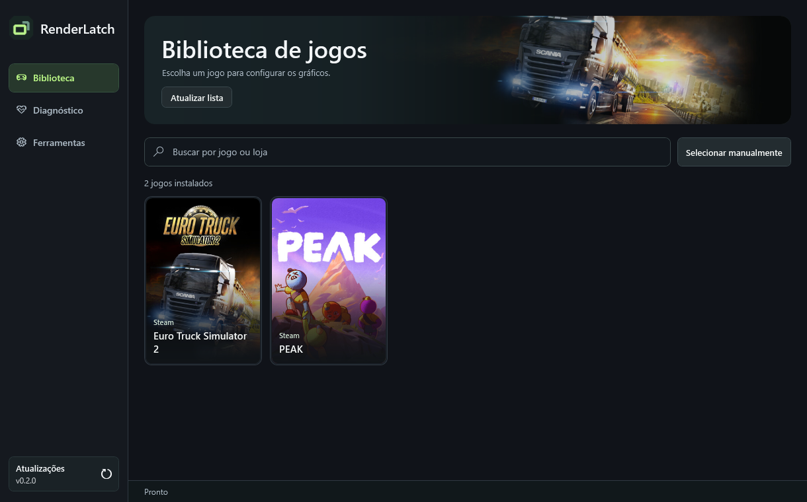
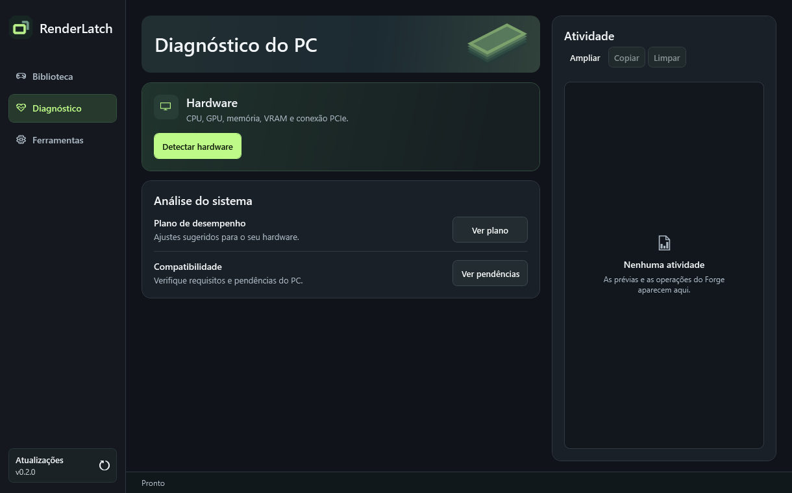
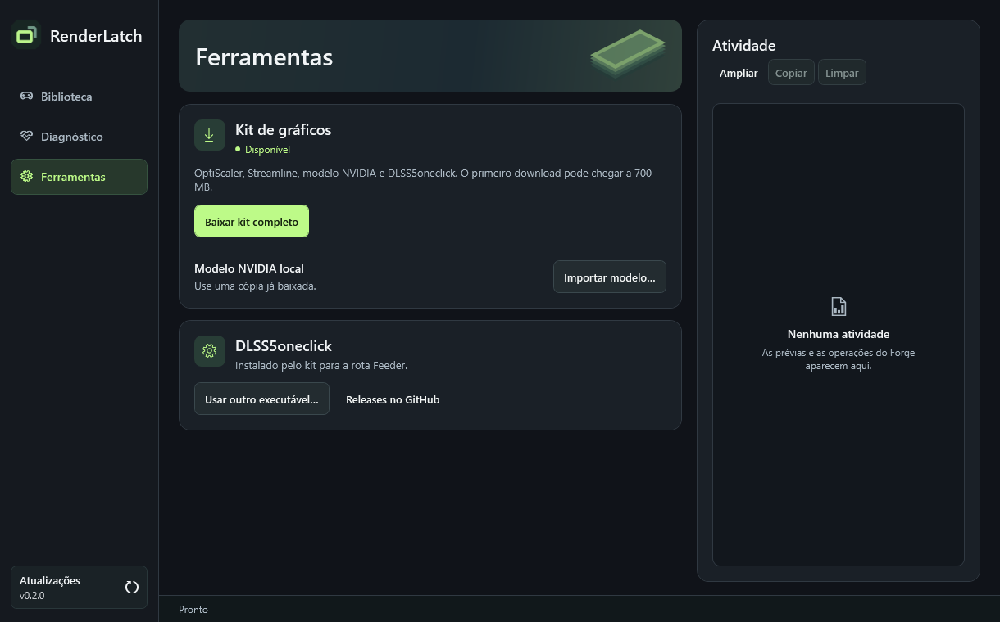

# RenderLatch

RenderLatch is a Windows desktop tool for configuring NVIDIA DLSS Neural Rendering, upscaling, and frame generation in compatible PC games. It detects installed games, previews changes before applying them, and keeps a record of the files it manages so you can undo an installation.

[Download for Windows x64](https://github.com/Hotelo1/RenderLatch/releases/latest/download/RenderLatch-windows-x64.exe) · [Release notes and checksums](https://github.com/Hotelo1/RenderLatch/releases)

Diagnostics and tools screenshots

## What you can do

- Find games installed through Steam, Epic Games, and GOG, or select an executable manually.
- Set up OptiScaler for games with native DLSS. For eligible games without native DLSS, use the Feeder route through DLSS5oneclick.
- Configure upscaling and frame generation independently in DirectX 12 and on compatible DirectX 11 Feeder installations. Supported options depend on the route, GPU, and game.
- Preview the target folder, selected options, DLLs, and expected changes before applying them.
- Inspect your GPU, VRAM, driver, CPU, memory, and PCIe connection. Apply a per-PC profile where the selected route supports one.
- Restore files managed by RenderLatch and undo supported resolution changes.

## Requirements

| Feature | Requirements |
| --- | --- |
| Desktop app | Windows 10 or 11 on x64 with the system Windows PowerShell 5.1 and WPF. Internet access is needed to download the optional graphics kit. |
| DLSS Neural Rendering | The supported configuration is an NVIDIA GeForce RTX 50 Series GPU, a compatible NVIDIA driver, and an authentic NVIDIA-signed **nvngx_dlssnr.dll** installed by the kit or imported from a compatible installation. |
| OptiScaler graphics controls | A compatible DirectX 12 game or a supported 64-bit DirectX 11 or 12 Feeder installation. The game or Feeder must supply the inputs required by the selected mode. |
| NVIDIA DLSS Frame Generation | RTX 40 or 50 Series for the option exposed by RenderLatch. Multi Frame Generation availability depends on GPU support and the in-game backend. |
| AMD FSR and Intel XeSS | FSR 3.1, FSR 4, and XeSS options depend on the installed backend and driver. The FSR 4 profiles in this kit require a compatible Radeon RX 9000 GPU. |

Compatibility varies by game, rendering API, GPU, and other installed mods. Use graphics injection only in games and modes that allow it. Keep anti-cheat settings intact. There is no FPS guarantee.

## Quick start

1. Download **RenderLatch-windows-x64.exe** from Releases and double-click it. The app runs without a separate install or source checkout.
2. Select a game in **Biblioteca** (**Library**). Under **Kit de instalação**, choose **Baixar kit completo** (**Download complete kit**). The same download is available in **Ferramentas** (**Tools**). A single operation prepares OptiScaler, NVIDIA Streamline, the NVIDIA-signed neural rendering model, and DLSS5oneclick. Allow roughly 700 MB for a first download. Activity shows each stage, and retries reuse verified downloads.
3. Wait for **Kit completo pronto para usar**. RenderLatch uses the installed DLSS5oneclick automatically. The model archive comes from the [RankFTW release mirror](https://github.com/RankFTW/rhi-repo/releases/tag/dlssnr-310.9.16-nvidia). RenderLatch verifies its archive checksum and the NVIDIA signature on the DLL. **Importar modelo NVIDIA…** lets you supply your own signed copy.
4. To configure a different game, return to **Biblioteca** (**Library**) and browse automatically detected Steam, Epic Games, and GOG installations. Search by game or store and select a card to open its settings. Steam covers come from the local library cache or Steam's CDN. A game without a cover shows its executable icon when the launcher provides the executable path. Use **Atualizar lista** (**Refresh list**) to rescan, or **Selecionar manualmente** (**Select manually**) to browse to an unlisted game.
5. Review the route and choose the desired graphics settings. Select **Ver prévia** (**Preview**) and review the **Atividade** (**Activity**) panel. **Ampliar** expands the log.
6. Close the game, choose **Aplicar instalação** (**Apply installation**), and reopen the game. New OptiScaler installations start with DLSS 5 Neural Rendering and Frame Generation disabled. Press **Insert** in the game to activate either feature. A Frame Generation backend selected in RenderLatch is prepared for manual activation.

The desktop UI is currently in Brazilian Portuguese. The steps above give the corresponding English labels.

### Update RenderLatch

Version 0.1.12 and later check GitHub Releases when the app opens and every 15 minutes while it is open. When a newer stable version is available, the sidebar shows **Atualização disponível** (**Update available**). Click the update button to download the new executable, verify its SHA-256, replace the copy you opened, and restart RenderLatch. The executable's folder must be writable. Earlier versions require a one-time manual download from Releases.

### Verify a download

Download the executable and its **.sha256** file from the same release. Compare the published hash with the SHA-256 shown by PowerShell.

~~~powershell
Get-FileHash .\RenderLatch-windows-x64.exe -Algorithm SHA256
~~~

The initial Windows release has no Authenticode signature. The checksum helps verify that your file matches the GitHub release asset.

## Installation routes

### Games with native DLSS

Select the game and use the automatically detected **OptiScaler** route. For DirectX 12, start with **Manter atual** (**Keep current**) or choose an upscaler and Frame Generation backend. Enable the appropriate graphics option inside the game when required. A game can offer DLSS Super Resolution without offering native DLSS Frame Generation.

### Games without native DLSS

1. Choose **Ferramentas → Baixar kit completo** to install DLSS5oneclick. To use a different copy, choose **Escolher outro executável…**. RenderLatch remembers your selection.
2. Select the game, preview the **Feeder** installation, and apply. Start the game and reach its menu so the Feeder can record the renderer. Close the game again.
3. For a supported 64-bit DirectX 11 or 12 game, enable **Adicionar menu OptiScaler ao Feeder**. In DirectX 11, select **Detectar automaticamente** or **Upscaler (OptiFG)** as the Frame Generation input. The DirectX 11 bridge requires a compatible swap chain and an active upscaler input. Select the graphics options, generate a fresh preview, and apply it. RenderLatch stores the original ReShade loader and RenoDX add-on so it can restore them later.
4. In the OptiScaler menu, use **OptiFG (Upscaler)** as the Frame Generation input when the game has no native FG input. Choose a compatible **FG Output**. Use **Save INI** and restart the game when changing the output.

**Optical F5Low** is the default GUI route for Windows x64 games. Select the actual game executable, choose a frame generator, preview, and apply with the game closed. RenderLatch downloads the pinned F5 v0.1.39 package and verifies its SHA-256. On first installation, Neural Rendering and Frame Generation start off. Open the overlay with **Insert**, go to **Frame Generation**, and enable **Active**. The optical input supplies motion even when a game has no native upscaler. The automatic choice uses NVIDIA DLSS-G on detected RTX 40/50 series GPUs and FSR FG otherwise. Euro Truck Simulator 2 and Sons of the Forest use the standard OptiScaler DLSS-G output with the same optical input when NVIDIA DLSS Frame Generation is selected. Sons of the Forest also blocks Steam and Epic overlays and Steam Input through the OptiScaler profile to avoid a graphics-hook conflict. On GeForce RTX, the Sons of the Forest profile uses the DX11 DLSS bridge so Neural Rendering continues when the game starts using its native DLSS in the world. Compatibility depends on the renderer, loader and GPU. **Undo installation** restores the previous profile. The CLI equivalent is `forge dlss5 --game "path/to/game.exe" --optical-f5 --dry-run`, followed by `--yes` in place of `--dry-run`.

With Optical F5Low deselected, American Truck Simulator in DirectX 11 uses a compatibility profile for Feeder + OptiScaler. RenderLatch leaves the Frame Generation bridge disabled on that profile so the game can start. Press **Insert** to enable DLSS 5 Neural Rendering.

The Feeder supplies a synthetic DLSS input using frame data from the game. OptiFG is experimental. HUD artifacts, intermittent interpolation, or an unavailable option are possible. The PEAK DirectX 12 setup has been tested with DLSS FG on an RTX 5060. That result does not establish compatibility with other games or GPUs.

## Performance and recovery

**Otimizar para este PC** (**Optimize for this PC**) applies a hardware-based configuration to an existing installation. The OptiScaler route adjusts the neural model's working scale. The Feeder route can change its DirectX 11 working resolution and supports a reversible resolution profile for selected DirectX 12 Unity games. Unsupported combinations report that there is no applicable adjustment.

The optional source-only native build compiles the RenderLatch executable for the current CPU. The NVIDIA model, GPU driver, and third-party DLLs remain the upstream binaries. For meaningful performance comparisons, use the same scene, resolution, and settings before and after each change.

Use **Manutenção → Desfazer instalação** (**Maintenance → Undo installation**) to restore an OptiScaler installation. In Feeder + OptiScaler mode, this returns the game to the original Feeder arrangement. A subsequent Feeder uninstall uses DLSS5oneclick, which can leave ReShade files in place. **Restaurar resolução** (**Restore resolution**) reverses the supported Unity resolution adjustment. Keep the **_dlss5forge** backup directory while the mod is installed.

## Troubleshooting

| Symptom | What to check |
| --- | --- |
| No games are detected | Choose **Selecionar manualmente** and select the actual game executable. |
| The kit is incomplete | Choose **Baixar kit completo** and check Activity for the failing stage. Retry to resume from verified files. Do not substitute **nvngx_dlss.dll** or **nvngx_dlssd.dll** for the model. |
| Preview is ready, but Apply is disabled | Generate a fresh preview after changing the game or any installation option. |
| The OptiScaler menu does not open | Confirm the selected route and renderer, restart the game, then press **Insert**. Feeder-only ReShade uses **Home**. |
| OptiFG shows **OFF** | Check that the upscaler is active and review **OptiScaler.log** and **dlss5-feed.log** beside the game executable. Some builds show a native DLSSG detection counter even when OptiFG is supplying frames. Streamline interpolation messages give better evidence for the NVIDIA output. |
| The game starts incorrectly after applying changes | Close it and use **Desfazer instalação**. Check for existing graphics wrapper DLLs before trying again. |

When filing an issue, include the game and build, renderer, GPU and driver, selected route, graphics options, and relevant log lines. Remove identifying paths and personal information from logs before posting them.

## Build from source

Use Windows x64, stable Rust with the **x86_64-pc-windows-msvc** target, and Visual Studio Build Tools with the C++ workload and Windows SDK. The SDK resource compiler embeds the Windows icon and version metadata.

~~~powershell
cargo test --locked
powershell -NoProfile -ExecutionPolicy Bypass -File .\tools\build-release.ps1
~~~

The packaging script writes **RenderLatch-windows-x64.exe** and its SHA-256 checksum to **dist/**. It uses the x64 CPU baseline for distribution. To build the local development executable for your CPU, run **build.ps1** from a source checkout. **INICIAR.cmd** opens the source checkout's interface.

The release uses Windows PowerShell and WPF from Windows. It extracts its embedded UI assets to **%LOCALAPPDATA%\RenderLatch\app\<version>** and reads downloaded graphics dependencies from **%LOCALAPPDATA%\RenderLatch\runtime**. Game backups live beside the affected game executable. The build does not package downloaded runtimes, proprietary models, or the OneClick binary.

### Publish a release

Update the version in **Cargo.toml** and **Cargo.lock**, commit the change, then push the matching **vX.Y.Z** tag. The [Windows release workflow](.github/workflows/release.yml) runs tests, builds the standalone Windows executable, and publishes the executable and checksum. A manual workflow run builds downloadable artifacts without publishing a release.

~~~powershell
git tag v0.1.2
git push origin v0.1.2
~~~

If hosted Actions is unavailable, build on a Windows x64 machine from the tagged source and upload the two assets with the [GitHub CLI](https://cli.github.com/). Confirm that a release for the tag does not already exist before using this fallback.

~~~powershell
git switch --detach v0.1.2
powershell -NoProfile -ExecutionPolicy Bypass -File .\tools\build-release.ps1
gh release create v0.1.2 dist/RenderLatch-windows-x64.exe dist/RenderLatch-windows-x64.exe.sha256 --verify-tag --generate-notes
~~~

## Acknowledgments

RenderLatch integrates work from [OptiScaler](https://github.com/optiscaler/OptiScaler), the [Dagherbou DLSS-NR fork](https://github.com/Dagherbou/OptiScaler_DLSSNR), the [DLSS-NR PreSR Multipass fork](https://github.com/jlrouzies-fr/OptiScaler-DLSSNR-PreSR-Multipass), [DLSS5-Feeder](https://github.com/jlrouzies-fr/DLSS5-Feeder), [DLSS5oneclick](https://github.com/faisalkindi/DLSS5oneclick), [ReShade](https://reshade.me/), [RenoDX](https://github.com/clshortfuse/renodx), and [NVIDIA Streamline](https://github.com/NVIDIA-RTX/Streamline).

RenderLatch is an independent project. NVIDIA DLSS, AMD FSR, and Intel XeSS belong to their respective owners. Third-party components remain subject to their own licenses. This repository currently has no separate open-source license.
